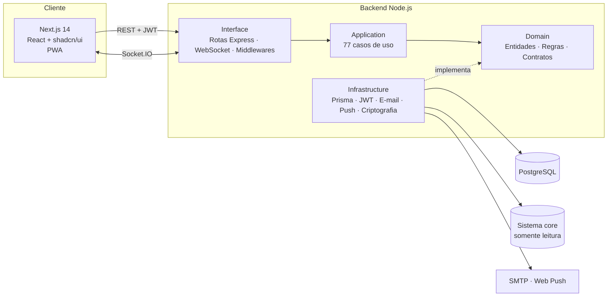
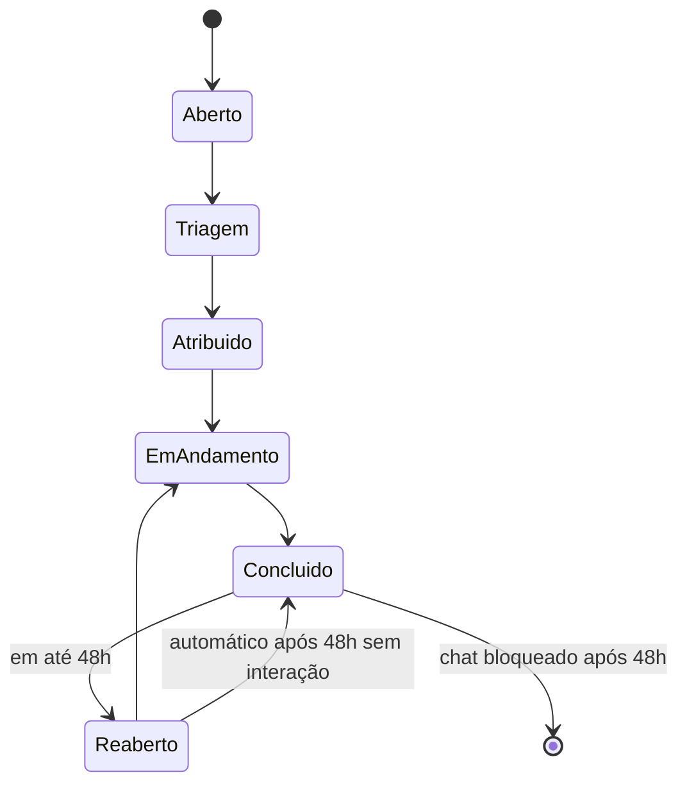

# Sistema de Chamados — PixCard

Plataforma web de abertura, triagem e acompanhamento de chamados, com SLA, chat em tempo real e controle de acesso por perfil. Projetada e desenvolvida por **Gustavo Aguilar**, do levantamento de requisitos ao deploy em produção.

**Tecnologias:** TypeScript · Next.js 14 · React · Node.js · Express · Prisma · PostgreSQL · Socket.IO · GitHub Actions

> **Sobre este documento:** o sistema é proprietário da PixCard. Aqui eu apresento o problema, a arquitetura e as decisões técnicas do projeto. Não há código-fonte, dados, credenciais nem informações internas da empresa.

---

## O problema

O suporte da PixCard recebia solicitações por canais soltos (e-mail, mensagens, telefone), sem registro centralizado, sem prazo de atendimento e sem histórico. As empresas parceiras também precisavam de um canal oficial para pedir acessos e relatar problemas, com cada uma vendo apenas os próprios dados.

## A solução

Um sistema de chamados feito sob medida para a operação da empresa:

- **Um canal único** para as equipes internas e as empresas parceiras abrirem chamados
- **SLA automático** calculado em horário comercial, com alertas antes do vencimento
- **Chat em tempo real** dentro de cada chamado, com anexos, notas internas e histórico completo
- **Perfis e permissões** configuráveis pelo administrador, sem precisar mexer no código
- **Painéis e relatórios** para a gestão acompanhar volume, prazos e recorrência dos problemas

---

## Números do projeto

| | |
|---|---|
| **88** endpoints REST | **77** casos de uso no domínio |
| **18** entidades no banco de dados | **48** migrations versionadas |
| **22** telas e **82** componentes React | **29** permissões granulares (RBAC) |
| **638** testes automatizados em **87** suítes | CI a cada push e pull request |

---

## Funcionalidades

**Chamados**
- Ciclo de vida completo: aberto → triagem → atribuído → em andamento → concluído
- Reabertura em até 48h, com escalonamento automático para prioridade crítica
- Conclusão automática de chamados reabertos sem interação
- Categorias configuráveis, com ordem definida por arrastar e soltar e restrição por perfil
- Formulários específicos por tipo de chamado (ex.: solicitação de acesso para vários usuários)
- Pastas no estilo Outlook (abertos, reabertos, concluídos, arquivados)
- Avaliação do atendimento pelo solicitante

**Comunicação**
- Chat em tempo real por chamado (WebSocket), com edição, exclusão e anexos de imagem
- Notas internas visíveis apenas para a equipe de suporte
- **Comunicados**: um único chamado enviado a vários destinatários, que conversam no mesmo chat
- Notificações no sistema, por **push** (PWA) e por **e-mail**

**SLA**
- Prazos por prioridade e por perfil, configuráveis pelo administrador
- Cálculo em **horário comercial** (seg–sex, 9h–18h, fuso de Brasília), independente do fuso do servidor
- Pausa e retomada do SLA (ex.: aguardando retorno do solicitante), sem contar o tempo pausado

**Gestão de usuários e empresas parceiras**
- Cadastro de parceiros validado automaticamente contra o sistema core da empresa
- Confirmação de identidade por link enviado ao e-mail oficial
- Hierarquia por empresa parceira: o supervisor aprova e gerencia apenas os usuários da própria empresa
- Aprovação, rejeição, ativação, redefinição de senha e exportação de usuários

**Gestão**
- Dashboard com KPIs, distribuição por status, prioridade e área, e tendência de abertura
- Relatórios de chamados exportados para **Excel**
- Lista de tarefas pessoal para a equipe de suporte
- Tutorial guiado no primeiro acesso e vídeos de ajuda

---

## Arquitetura

Monorepo TypeScript com três pacotes: **frontend**, **backend** e **shared** (schemas e regras usados pelos dois lados, para que a validação seja a mesma no navegador e na API).

O backend segue **arquitetura hexagonal (Ports & Adapters)**: as regras de negócio não dependem de framework, banco ou serviços externos, o que permite testá-las isoladamente e trocar a infraestrutura sem reescrever o domínio.

### Ciclo de vida do chamado

---

## Destaques técnicos

### Motor de SLA em horário comercial
O prazo conta apenas o tempo de expediente: o que sobra às 18h continua às 9h do próximo dia útil, e prazos em dias contam dias úteis. O cálculo é feito sempre no fuso de Brasília, independente de onde o servidor roda. Isso corrigiu prazos que saíam errados com o servidor em UTC. A pausa de SLA guarda o tempo restante e o devolve na retomada.

### Segurança e LGPD
- Autenticação **JWT** com access token curto (15 min) e refresh token em **cookie httpOnly**
- Senhas com **bcrypt** e mensagens do chat **criptografadas no banco com AES-256-GCM**
- **RBAC** com 29 permissões, checado em toda rota da API, e não apenas escondido na interface
- Controle de acesso por chamado também no **WebSocket**: ninguém entra na sala de uma conversa que não é sua
- **Rate limiting** em login, cadastro e recuperação de senha, e cabeçalhos de segurança com Helmet
- Mensagens de erro que não revelam se um e-mail, CPF ou login já existe (proteção contra enumeração)
- Uploads validados pela **assinatura binária do arquivo** (magic bytes), sem confiar no tipo informado pelo navegador
- Anexos servidos somente depois de confirmar que o usuário tem acesso ao chamado
- Histórico de edições das mensagens guardado para auditoria

### Integração com o sistema core
Conexão **somente leitura** a um banco PostgreSQL externo para validar o cadastro das empresas parceiras e listar os convênios ativos. Se a integração estiver fora do ar, o sistema continua funcionando e apenas os recursos que dependem dela ficam indisponíveis, com uma mensagem clara para o usuário.

### Tempo real e notificações
Socket.IO para chat e atualização de status ao vivo, **Web Push** (VAPID) com service worker para notificações mesmo com o sistema fechado, e e-mails transacionais via SMTP. Uma falha no envio de e-mail nunca derruba a operação principal.

### Qualidade
- **638 testes automatizados**: unitários nos casos de uso e de integração nas rotas contra um PostgreSQL real
- Pipeline no **GitHub Actions**: build do pacote compartilhado, checagem de tipos do front e do back, migrations e testes
- Schemas **Zod** compartilhados entre o front-end e a API

### Deploy e operação
- Script de **deploy automatizado**, com modo de simulação (dry-run)
- **Backup diário** do banco com rotação local e cópia externa para S3, agendado via systemd
- **Hardening de SSH** (apenas chave, sem root), com trava de segurança contra bloqueio acidental
- **Teste de carga** simulando acessos simultâneos de vários IPs para dimensionar o servidor
- Migrations versionadas com Prisma e scripts de manutenção (recálculo de SLA, criptografia retroativa)

---

## Stack

| Camada | Tecnologias |
|---|---|
| **Front-end** | Next.js 14 (App Router), React 18, TypeScript, Tailwind CSS, shadcn/ui, Recharts, ExcelJS, PWA |
| **Back-end** | Node.js, Express, TypeScript, Prisma ORM, Socket.IO, Zod |
| **Banco de dados** | PostgreSQL |
| **Segurança** | JWT, bcrypt, AES-256-GCM, Helmet, express-rate-limit |
| **Notificações** | Web Push (VAPID), Nodemailer (SMTP) |
| **Testes** | Jest, Testing Library, Supertest |
| **DevOps** | GitHub Actions, Linux, systemd, Bash, backups em S3 |

---

## Meu papel

Fui responsável pelo projeto inteiro:

- **Levantamento de requisitos** com as áreas de negócio e com as empresas parceiras
- **Arquitetura** e **modelagem de dados**
- Desenvolvimento do **back-end** e do **front-end**
- **Integração** com o sistema core da empresa
- **Testes automatizados** e pipeline de **CI**
- **Deploy**, monitoramento, backups e segurança do servidor
- **Documentação**, manual do usuário e vídeos tutoriais

---

  Projeto desenvolvido para a PixCard. Código-fonte proprietário, não incluído neste repositório.

